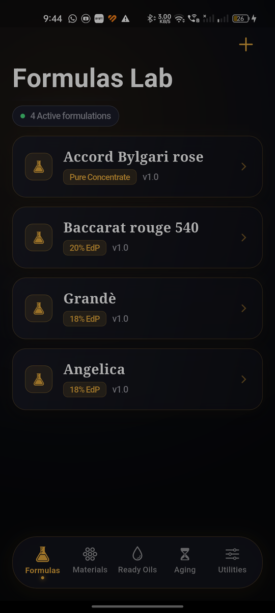
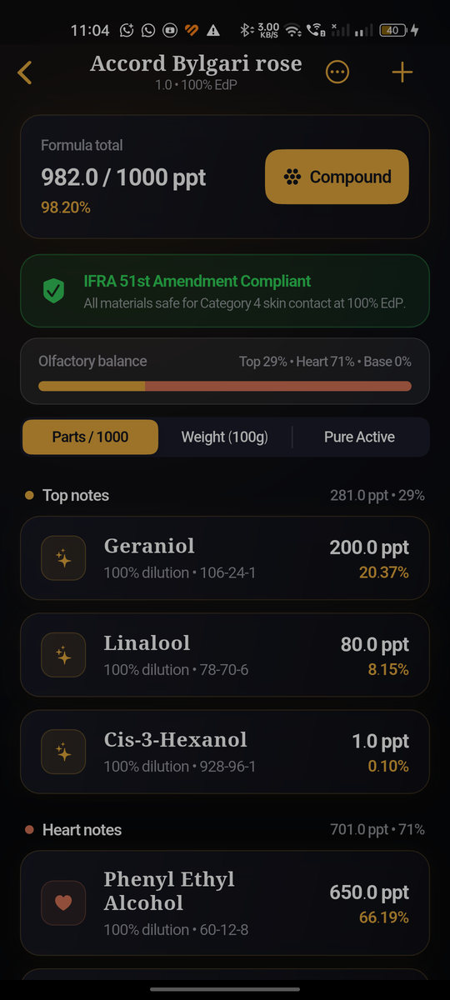
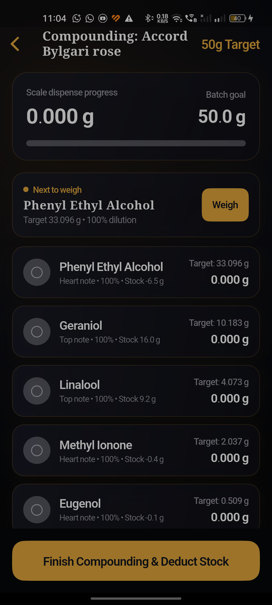
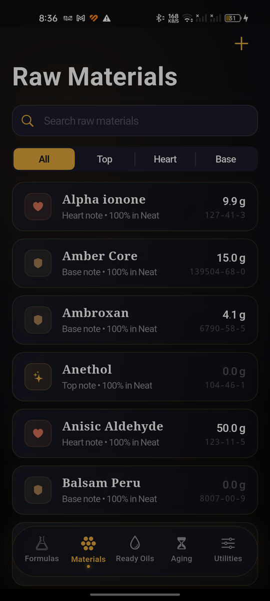
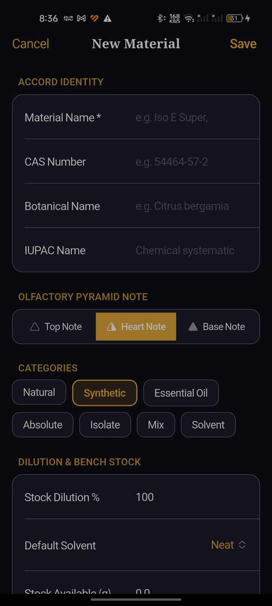
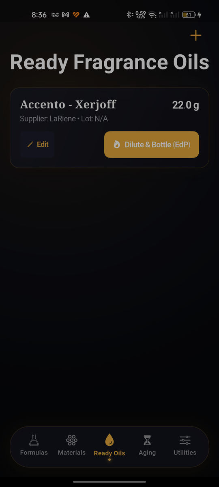
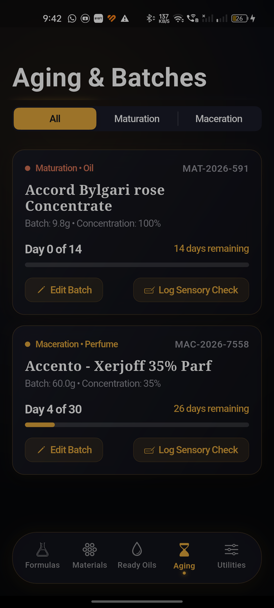
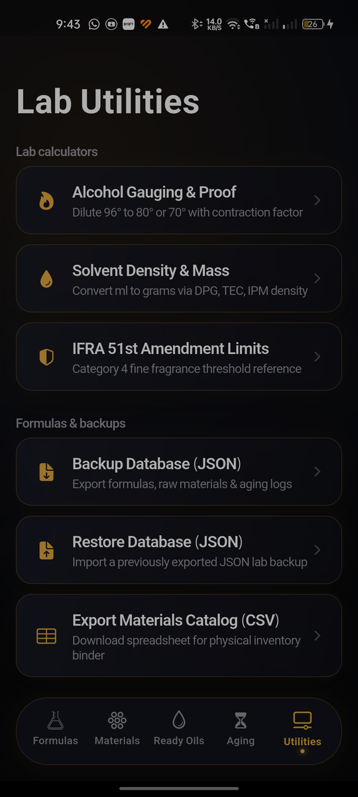

<p align="center">
  
</p>

<h1 align="center">Perfumer Lab</h1>

<p align="center">
  An offline-first mobile workspace for artisanal perfumers and fragrance formulators built with Flutter, Drift (SQLite), and Riverpod.
</p>

<p align="center">
  <a href="../../releases/latest">Download Android Beta (APK)</a> •
  <a href="../../issues/new?template=bug_report.md">Report a Bug</a> •
  <a href="../../issues/new?template=feedback.md">Share Feedback</a>
</p>

---

## Features & Screenshots

### 1. Formulas Studio & Bench Compounding
Formulate in parts-per-thousand (PPT), inspect live Top / Heart / Base olfactory pyramid distribution, validate IFRA 51st compliance per product category (`Cat 1`–`Cat 12`), and execute guided **Bench Compounding** batches with atomic stock deduction.

<p align="center">
  
  
  
</p>

---

### 2. Raw Materials Organ & Hidden 7,406-CAS Auto-Lookup
Track dilutions, solvents, density, stock mass, cost per gram, and olfactory notes. When adding a material, typing a **CAS number** automatically queries an offline **7,406-CAS** reference database (+1,303 alternate CAS numbers) to suggest `Ideal Max %` and **GHS Safety Classifications** (`Flammable`, `Irritant`, `Health Hazard`, `Environmental`, `Corrosive`, `Acute Toxic`) — without cluttering your personal inventory list.

<p align="center">
  
  
</p>

---

### 3. Official IFRA 51st Amendment Library
Search all **263 IFRA Standards** across all **18 categories** (`Cat 1`–`Cat 12`) and **302 Natural Complex Substances (NCS)** with constituent mappings completely offline inside Lab Utilities.

<p align="center">
  
</p>

---

### 4. Ready Oils & Bottling
Calculate final dilution ratios, concentrate weights, alcohol/carrier volumes, and bottling batches.

<p align="center">
  
</p>

---

### 5. Aging & Maceration Tracker
Log compounding batches and record olfactive evaluations over time as your blends mature.

<p align="center">
  
</p>

---

### 6. Lab Utilities & Backups
Alcohol gauging & proof calculator, solvent mass/density converter, IFRA 51st browser, and JSON/CSV database backup export.

<p align="center">
  
</p>

---

## Try the Beta (Android)

1. Download the latest `app-release.apk` from the **[Releases](../../releases/latest)** page.
2. Open the APK on your Android device (if **Google Play Protect** asks to scan the app because it is installed outside the Play Store, tap **Scan app** to complete installation).
3. Please share your experience or report bugs via **[GitHub Issues](../../issues/new/choose)**!

## Build from Source

Requires Flutter SDK (Dart `^3.14.0`).

```bash
flutter pub get
flutter test
flutter build apk --release
```
